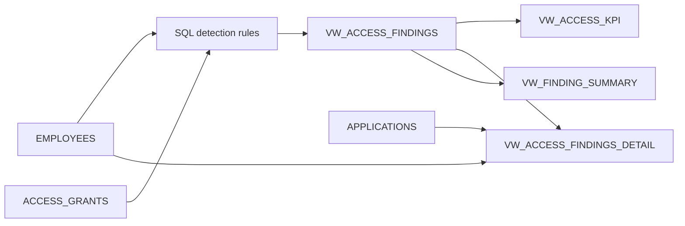

# Technology Risk Analytics: User Access Monitoring

A personal Snowflake SQL project using synthetic data to identify access permissions that need investigation. This is a learning prototype, not a production monitoring system or an employer project. No company or customer data is included.

## Business question

Which active permissions warrant review because the employee has left, the employee record cannot be matched, or the permission has expired?

## Tools

Snowflake, SQL, Snowsight charts. Concepts: JOINs, UNION ALL, CASE, MERGE, views, data-quality checks, distinct counts, and KPI definition.

## Data model

- `EMPLOYEES`: 5 fictional employees; one row per employee ID.
- `APPLICATIONS`: 2 fictional systems; one row per application ID.
- `ACCESS_GRANTS`: 6 permissions; one row per grant ID.

Employee and application IDs connect permissions to their reference records. E999 intentionally has no employee record. G003 intentionally triggers two rules.

## Detection rules

| Rule | Condition | Interpretation |
|---|---|---|
| Terminated employee | Employee status is TERMINATED and permission is active | Review retained access |
| Employee not found | Active permission has no matching employee | Investigate identity or data completeness; not a confirmed violation |
| Expired access | Active permission expiry date precedes 2026-09-29 | Review access beyond its approved period |

Expiry is inclusive of its date. A NULL expiry means no expiry is recorded, not automatically a finding. All policies and classifications are exercise assumptions, not Fidelity policies.

## Expected demonstration results

| Metric | Value |
|---|---:|
| Active permissions | 5 |
| Findings | 4 |
| Distinct flagged permissions | 3 |
| Flagged active permissions | 60% |

Two expiration findings, one termination finding, and one unmatched-employee finding are expected. G003 triggers both termination and expiration rules. Therefore 4 findings do not mean 4 affected permissions. These small synthetic-data results are not business impact claims or representative risk rates.

The percentage denominator is active permissions, not all permissions. A zero denominator returns NULL (not applicable), not 0%.

## Run the project

1. Use a personal Snowflake sandbox with SYSADMIN privileges and available compute credits.
2. Open `technology_risk_access_monitoring.sql` in a new SQL file.
3. Execute sections in numerical order; select complete statements through the semicolon.
4. Review `VW_DATA_QUALITY_CHECKS`. Each issue count should be zero before trusting the chart.
5. Run the section 10 checks: the original demonstration data should return PASS.
6. For the chart, execute the category/count query in section 9, select Chart, and use FINDING_CATEGORY on X and FINDING_COUNT on Y with SUM aggregation.

The warehouse is X-Small with 60-second auto-suspend. Running queries consumes trial credits or billed resources according to your account terms.

## Reruns and existing data

Tables are created only if missing. Seed MERGEs insert missing IDs without overwriting existing records. Sequential reruns do not duplicate seed IDs. They do not repair pre-existing duplicates or reset remediation changes. Views are replaced to keep rule definitions current. Existing rows that differ from the demo may legitimately cause expected-result checks to fail.

## Validation

- During guided Snowflake execution, the component queries produced the expected findings and 5 / 3 / 60% KPI.
- Deactivating G003 removed its termination finding; restoring the synthetic permission restored it.
- Adding an expiration date to G003 increased finding count without increasing distinct flagged permissions.
- The consolidated script's query logic was additionally checked locally using SQLite-compatible adaptations, including the zero-denominator case.
- The final consolidated script has not yet been compiled end-to-end in Snowflake. Local checks are not a Snowflake compilation guarantee.

## Limitations

This is a manually executed prototype with a tiny synthetic dataset. It has no scheduled refresh, alerting, remediation workflow, or approval-exception handling. The fixed assessment date supports repeatable date comparisons; current employee/access status is not a historical snapshot. The findings require investigation before action. Duplicate/missing data checks are diagnostics, not automatic execution gates or enforced key constraints.

## What I learned

- Use INNER JOIN for matched employee analysis and LEFT JOIN to retain unmatched access records.
- Separate finding-level counts from permission-level counts.
- Validate reference keys before trusting JOIN-based reporting.
- Verify rule behavior through controlled changes to synthetic records.
- Explain the difference between system criticality and finding priority.

## Possible extensions

Access-review due dates, login activity, documented exceptions, scheduled tasks, alerting, and a Power BI report.

